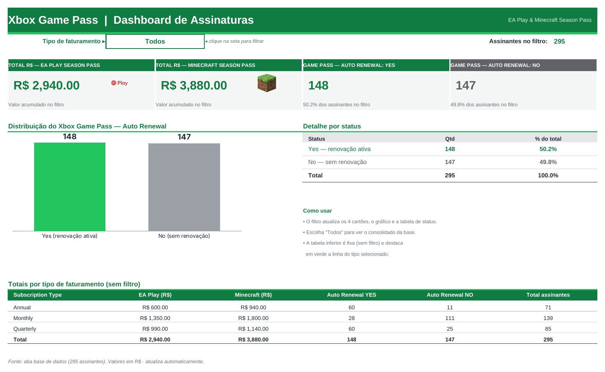

# 🎮 Dashboard de Assinaturas Xbox Game Pass (Excel)

Dashboard de vendas interativo, construído inteiramente em Excel (fórmulas + lista suspensa + gráfico), para analisar assinaturas do **Xbox Game Pass** e dos complementos **EA Play Season Pass** e **Minecraft Season Pass**.



## 📌 Perguntas de negócio respondidas

1. **Quanto foi arrecadado (R$) com o EA Play Season Pass?**
2. **Quanto foi arrecadado (R$) com o Minecraft Season Pass?**
3. **Como se distribui a renovação automática (Auto Renewal) do Game Pass: Yes × No?** Contagem e proporção.

Todos os indicadores e o gráfico podem ser filtrados por **tipo de faturamento** (`Subscription Type`): `Annual`, `Monthly`, `Quarterly` ou `Todos`.

## 🗂️ Estrutura do repositório

```
.
├── Dashboard_Xbox.xlsx          # Planilha final (base + cálculos + dashboard)
├── vba/
│   └── CriarDashboardXbox.bas   # Macro opcional que recria o dashboard em um clique
├── docs/
│   └── dashboard.png            # Captura de tela usada neste README
└── README.md
```

## 📊 Dados utilizados

Aba **`Bases`** (tabela `Tabela1`), com **295 registros** e 13 colunas:

| Coluna | Descrição |
|---|---|
| `Subscriber ID` | Identificador do assinante |
| `Name` | Nome do assinante |
| `Plan` | Plano: `Ultimate`, `Core` ou `Standard` |
| `Start Date` | Data de início da assinatura |
| `Auto Renewal` | Renovação automática do Game Pass: `Yes` / `No` |
| `Subscription Price` | Preço da assinatura do Game Pass |
| `Subscription Type` | Tipo de faturamento: `Annual`, `Monthly` ou `Quarterly` |
| `EA Play Season Pass` | Contratou o EA Play? `Yes` / `No` |
| `EA Play Season Pass Price` | Valor do EA Play em R$ (`-` quando não contratado) |
| `Minecraft Season Pass` | Contratou o Minecraft Pass? `Yes` / `No` |
| `Minecraft Season Pass Price` | Valor do Minecraft Pass em R$ (`0` quando não contratado) |
| `Coupon Value` | Desconto aplicado |
| `Total Value` | Valor total da transação |

**Pontos de atenção na base**

- Na coluna de preço do EA Play, quem não contratou tem o texto `-`, e não `0`. As funções `SOMASES`/`SUMIFS` ignoram texto, e as fórmulas ainda exigem `EA Play Season Pass = "Yes"` por segurança.
- Os valores de `Total Value` **não** são usados nos KPIs pedidos; os totais de EA Play e Minecraft vêm das colunas de preço de cada complemento.
- Se a base contiver nomes de pessoas reais, **anonimize antes de publicar** o repositório (por exemplo, substitua a coluna `Name` por um ID).

## 🧱 Estrutura do arquivo Excel

| Aba | Função |
|---|---|
| `Assets` | Paleta de cores e logos usados no visual |
| `Bases` | Base de dados bruta (`Tabela1`) |
| `Cálculos` | Parâmetro do filtro, KPIs, resumo por tipo, dados do gráfico e checagens |
| `Dashboard` | Filtro, cartões de KPI, gráfico Yes × No e tabelas de apoio |

> Os nomes das abas usam o caractere combinante U+0333 (ex.: `B̳ases`). Ao escrever fórmulas à mão, selecione a aba com o mouse em vez de digitar o nome.

### Como o filtro funciona

1. A célula `Dashboard!D5` tem uma **lista suspensa** (Validação de Dados) com `Todos, Annual, Monthly, Quarterly`.
2. Em `Cálculos!C6`, o valor vira um critério:
   ```excel
   =SE(C5="Todos";"*";C5)
   ```
   O curinga `*` faz o `SOMASES`/`CONT.SES` considerar todos os tipos.
3. Todas as fórmulas dos KPIs usam esse critério. O Dashboard apenas **lê** a aba `Cálculos`.

### Fórmulas principais (em português)

```excel
Total EA Play (R$)      =SOMASES(Bases!I2:I5000; Bases!H2:H5000;"Yes"; Bases!G2:G5000; $C$6)
Total Minecraft (R$)    =SOMASES(Bases!K2:K5000; Bases!J2:J5000;"Yes"; Bases!G2:G5000; $C$6)
Auto Renewal = Yes      =CONT.SES(Bases!E2:E5000;"Yes"; Bases!G2:G5000; $C$6)
Auto Renewal = No       =CONT.SES(Bases!E2:E5000;"No";  Bases!G2:G5000; $C$6)
Total de assinantes     =CONT.SES(Bases!G2:G5000; $C$6)
% Yes                   =SEERRO(C12/C14;0)
```

As fórmulas leem as linhas 2 a 5000, então novas linhas na base entram automaticamente. A aba `Cálculos` também traz um **resumo fixo por tipo** (sem filtro), que alimenta a tabela do rodapé do Dashboard, e **checagens** que comparam esses totais com a soma direta da base.

### Resultados de referência (filtro "Todos")

| Indicador | Valor |
|---|---|
| EA Play Season Pass | R$ 2.940,00 |
| Minecraft Season Pass | R$ 3.880,00 |
| Auto Renewal **Yes** | 148 (50,2%) |
| Auto Renewal **No** | 147 (49,8%) |

| Tipo | EA Play (R$) | Minecraft (R$) | Yes | No | Total |
|---|---:|---:|---:|---:|---:|
| Annual | 600 | 940 | 60 | 11 | 71 |
| Monthly | 1.350 | 1.800 | 28 | 111 | 139 |
| Quarterly | 990 | 1.140 | 60 | 25 | 85 |
| **Total** | **2.940** | **3.880** | **148** | **147** | **295** |

## 🎨 Design

Tema Xbox/gaming, com a paleta definida na aba `Assets`:

| Uso | Cor |
|---|---|
| Verde escuro (cabeçalhos, destaques) | `#107C41` |
| Verde Xbox (barra "Yes") | `#22C55E` |
| Verde-lima (apoio) | `#9BC848` |
| Cinza neutro (barra "No", fundos) | `#E8E6E9` e tons de cinza |
| Branco | `#FFFFFF` |

## ▶️ Como usar

1. Baixe `Dashboard_Xbox.xlsx` e abra no **Microsoft Excel** (2010 ou superior).
2. Abra a aba **Dashboard** e escolha o tipo de faturamento na lista suspensa da célula `D5`.
3. Os cartões, o gráfico e a tabela de status atualizam na hora.

Para usar com **seus próprios dados**, cole-os na aba `Bases`, mantendo as mesmas colunas e a mesma ordem. Os valores textuais devem ser exatamente `Yes`/`No` e `Annual`/`Monthly`/`Quarterly`.

## 🔁 Como reproduzir do zero

### Opção A — Manualmente (sem macros)

1. Crie as abas `Bases`, `Cálculos` e `Dashboard`, e cole a base como tabela (`Ctrl+T`).
2. Em `Cálculos`, monte os blocos: filtro (`C5:C6`), KPIs (`C10:C16`), resumo por tipo (`B19:G23`), dados do gráfico (`B27:C28`) e checagens.
3. No `Dashboard`, crie a lista suspensa em `D5` (Dados → Validação de Dados → Lista: `Todos,Annual,Monthly,Quarterly`).
4. Insira os cartões ligando cada um à célula correspondente de `Cálculos` (por exemplo `=Cálculos!C10`).
5. Insira um gráfico de colunas com os dados de `Cálculos!B27:C28`. Pinte "Yes" de `#22C55E` e "No" de cinza, ative os rótulos de dados e remova legenda e linhas de grade.
6. Aplique a formatação condicional na tabela por tipo (`=$B28=$D$5`) para destacar a linha selecionada.

### Opção B — Macro VBA (um clique)

1. Abra a planilha com a aba `Bases` preenchida e salve como **`.xlsm`**.
2. Pressione `Alt+F11` → *Arquivo → Importar Arquivo…* → selecione `vba/CriarDashboardXbox.bas`.
3. Pressione `Alt+F8`, escolha `CriarDashboard` e clique em **Executar**.

O macro recria as abas `Cálculos` e `Dashboard` com fórmulas, filtro, gráfico e formatação.

> **Observações:** o arquivo `.bas` está em codificação Windows-1252 (necessária para o editor do VBA importar os acentos corretamente). O macro não insere os logos de EA Play e Minecraft nos cartões; copie-os da aba `Assets`, se desejar.

### Opção C — Segmentação de Dados (Slicer)

Se preferir um Slicer à lista suspensa:

1. Insira uma **Tabela Dinâmica** a partir da `Tabela1`, com `Subscription Type` nas linhas, `Auto Renewal` nas colunas e a contagem de `Subscriber ID` como valor.
2. Vá em *Análise de Tabela Dinâmica → Inserir Segmentação de Dados* e marque `Subscription Type`.
3. Crie o gráfico a partir da tabela dinâmica e, para os KPIs em R$, outra tabela dinâmica (soma dos preços de EA Play e Minecraft) ligada ao mesmo Slicer em *Conexões de Relatório*.

## ✅ Requisitos

- Microsoft Excel 2010 ou superior (Windows ou Mac). As fórmulas usam apenas `SOMASES`, `CONT.SES`, `SE`, `SEERRO`, `SOMA` e `TEXTO`, sem funções dinâmicas do Microsoft 365.
- Macros (opcional): Excel para Windows, com a execução de macros habilitada.

## 🛠️ Tecnologias

Excel (fórmulas, Validação de Dados, formatação condicional, gráficos) · VBA (opcional)

## 📄 Licença

Defina a licença do projeto (por exemplo, MIT) antes de publicar.
